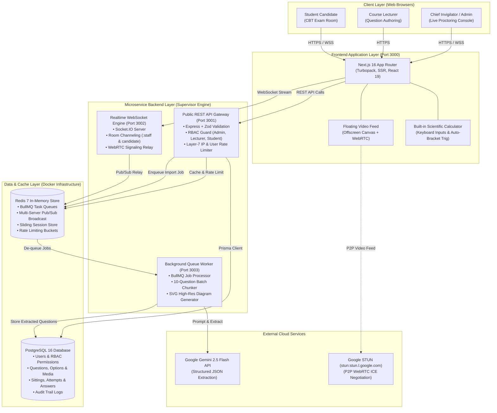
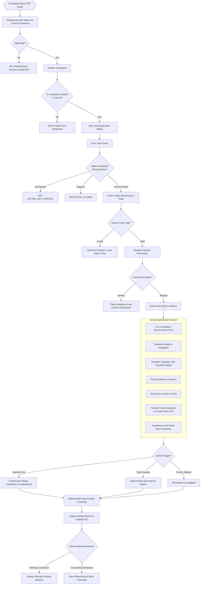
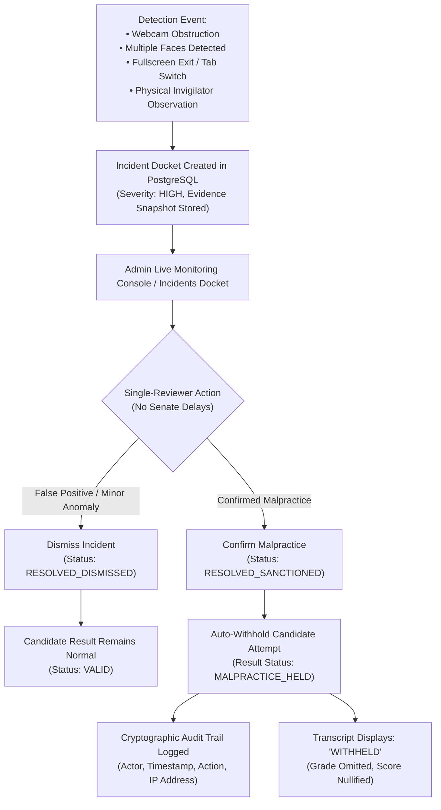
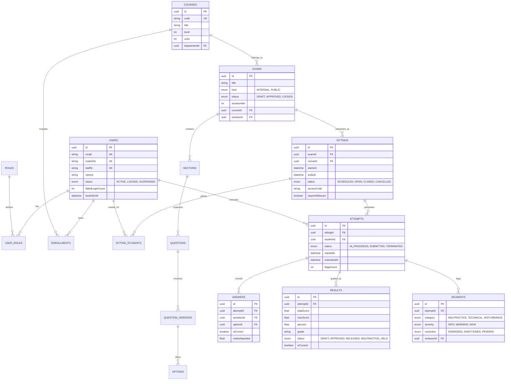

# LASUSTECH Computer-Based Testing (CBT) System
# Complete Architecture & Presentation Diagrams for Eraser.io

> **How to use in Eraser.io**:
> 1. Open [Eraser.io](https://app.eraser.io) and create a new canvas or document.
> 2. **Option A (Instant Diagram-as-Code)**: Click **Insert > Diagram-as-Code** (or press `/diagram`), select the diagram type, and paste the code block directly.
> 3. **Option B (Mermaid Import)**: In Eraser, choose **Insert > Mermaid**, and paste any of the Mermaid blocks below. Eraser will instantly render interactive, customizable visual diagrams with colors, icons, and layout nodes.

---

## 1. System High-Level Architecture (Eraser Diagram-as-Code)

Copy and paste this into an **Eraser.io Architecture Diagram**:

```eraser
// LASUSTECH CBT System Architecture
direction right

Users [icon: users, color: blue] {
  Student [icon: user, label: "Student Candidate"]
  Lecturer [icon: graduation-cap, label: "Course Lecturer"]
  Admin [icon: shield, label: "Chief Invigilator / Admin"]
}

Frontend [icon: layout, color: purple] {
  NextApp [icon: globe, label: "Next.js 16 Web Application\n(Port 3000 • SSR & Turbopack)"]
  ExamRoom [icon: monitor, label: "Live CBT Room\n(Floating Video & Calc)"]
  LiveMonitor [icon: eye, label: "Invigilator Console\n(Multi-Density Grid)"]
}

BackendServices [icon: server, color: green] {
  RestApi [icon: code, label: "Public REST API Gateway\n(Port 3001 • Express & Zod)"]
  WebSocketEngine [icon: radio, label: "Realtime WebSocket Engine\n(Port 3002 • Socket.IO)"]
  QueueWorker [icon: cpu, label: "Background Queue Worker\n(Port 3003 • BullMQ)"]
}

DataLayer [icon: database, color: amber] {
  PostgreSQL [icon: database, label: "PostgreSQL 16 DB\n(Prisma ORM • Connection Pool)"]
  Redis [icon: layers, label: "Redis 7 In-Memory\n(Pub/Sub • BullMQ • Rate Limiter)"]
}

ExternalAI [icon: cloud, color: rose] {
  Gemini [icon: zap, label: "Google Gemini 2.5 Flash\n(Question Extraction & SVG)"]
  STUN [icon: broadcast, label: "Google STUN Server\n(WebRTC NAT Discovery)"]
}

// Relationships & Data Flows
Student > NextApp: Access CBT Portal
Lecturer > NextApp: Author Questions
Admin > NextApp: Manage Schedule

NextApp > RestApi: HTTPS / REST (JWT Bearer)
NextApp > WebSocketEngine: WSS (Realtime Events)

ExamRoom > WebSocketEngine: Camera Frames (every 3.5s)
ExamRoom > STUN: P2P ICE Traversal
LiveMonitor > WebSocketEngine: Proctor Interventions & Feeds

RestApi > PostgreSQL: Query / Mutate (Prisma)
RestApi > Redis: L7 Rate Limiting & Auth Tokens
WebSocketEngine > Redis: Multi-node Pub/Sub
QueueWorker > Redis: BullMQ Job Queue
QueueWorker > Gemini: Batch AI Extraction (10 Qs)
QueueWorker > PostgreSQL: Persist Questions & Media
```

---

## 2. End-to-End System Architecture (Mermaid Flowchart)

Copy and paste this into an **Eraser.io Mermaid Block**:



---

## 3. Student Candidate CBT Exam Lifecycle (Mermaid Flowchart)

Copy and paste this into an **Eraser.io Mermaid Block**:



---

## 4. Dual-Tier Live Video Proctoring & WebRTC Signaling (Eraser Sequence Diagram)

Copy and paste this into an **Eraser.io Sequence Diagram**:

```eraser
// Dual-Tier Video Proctoring Sequence Flow
title Dual-Tier Video Proctoring & Real-Time Monitoring Flow

Candidate [icon: user, label: "Candidate (Browser)"]
SocketServer [icon: radio, label: "WebSocket Engine (:3002)"]
AdminConsole [icon: shield, label: "Invigilator Console"]
GoogleSTUN [icon: broadcast, label: "Google STUN Server"]

// Sitting Room Initialization
AdminConsole > SocketServer: join_sitting(sittingId) [Privileged Staff Room]
Candidate > SocketServer: join_sitting(sittingId) [Candidate Room]

// Tier 1: Continuous Frame Snapshot Stream (Multi-Density Grid)
loop Every 3.5 Seconds
  Candidate > Candidate: Draw video frame to 160x120 Canvas
  Candidate > SocketServer: emit("camera_frame", { sittingId, studentId, frame })
  SocketServer > AdminConsole: emit("candidate_camera_frame", { studentId, frame, ts })
  AdminConsole > AdminConsole: Update CandidateCard video thumbnail & LIVE badge
end

// Tier 2: Invigilator Candidate Inspection & WebRTC P2P Stream
AdminConsole > AdminConsole: Invigilator clicks "Inspect Candidate"
AdminConsole > SocketServer: emit("request_live_feed", { sittingId, studentId, invigilatorSocketId })
SocketServer > Candidate: emit("request_live_feed", { invigilatorSocketId })

Candidate > GoogleSTUN: Request ICE Candidates (NAT Discovery)
Candidate > SocketServer: emit("webrtc_signal", { sdp: Offer, targetSocketId })
SocketServer > AdminConsole: emit("webrtc_signal", { sdp: Offer, senderSocketId })

AdminConsole > GoogleSTUN: Request ICE Candidates
AdminConsole > SocketServer: emit("webrtc_signal", { sdp: Answer, targetSocketId })
SocketServer > Candidate: emit("webrtc_signal", { sdp: Answer, senderSocketId })

Candidate > AdminConsole: Direct P2P Video Track Stream (30 FPS WebRTC)
note over AdminConsole: If P2P negotiates: render 30 FPS video.\nIf firewall delays: fallback to Tier 1 snapshot.

// Mid-Exam Interventions
AdminConsole > SocketServer: emit("sitting.broadcast", { message: "10 mins remaining!" })
SocketServer > Candidate: emit("sitting.broadcast", { message })
Candidate > Candidate: Display Modal Alert Pop-up on Student Interface
```

---

## 5. Lecturer AI Question Bank & SVG Generation Pipeline (Mermaid Flowchart)

Copy and paste this into an **Eraser.io Mermaid Block**:

```mermaid
flowchart LR
    subgraph INPUT["Document Ingestion"]
        DOC["Exam File Upload<br/>(PDF, DOCX, TXT)"]
        LEC["Course Lecturer"]
        LEC -->|Uploads via Web UI| DOC
    end

    subgraph QUEUE_INGESTION["Asynchronous Queue Tier"]
        API["REST API Endpoint<br/>/api/v1/lecturer/import"]
        BULLMQ[("BullMQ Redis Queue<br/>Job: 'extract-questions'")]
        DOC --> API
        API -->|Enqueue File Path| BULLMQ
    end

    subgraph WORKER_PROCESSING["Background Worker Execution"]
        WORKER["Worker Process (:3003)"]
        PARSE["Text & Table Extractor"]
        CHUNK["Batch Partitioner<br/>(Strict 10-Question Windows)"]
        
        BULLMQ --> WORKER
        WORKER --> PARSE
        PARSE --> CHUNK
    end

    subgraph AI_PIPELINE["Gemini AI Processing"]
        GEMINI["Google Gemini 2.5 Flash<br/>(Structured Output Schema)"]
        JSON_PARSER["Resilient JSON Recovery Parser<br/>(Auto-Repairs Truncated AI Outputs)"]
        SVG_GEN["High-Resolution SVG Generator<br/>(Charts, Graphs & Geometry)"]
        
        CHUNK -->|Batch 1 (Q1-Q10)| GEMINI
        CHUNK -->|Batch 2 (Q11-Q20)| GEMINI
        GEMINI --> JSON_PARSER
        JSON_PARSER --> SVG_GEN
    end

    subgraph PERSISTENCE["Database & Question Bank"]
        DB[("PostgreSQL Database<br/>• Question Version<br/>• Options (A, B, C, D)<br/>• Stem Media (SVG)")]
        PREVIEW["Lecturer Review Studio<br/>• Live SVG Rendering<br/>• Inline Question Editor<br/>• One-Click Approval"]
        
        SVG_GEN --> DB
        DB --> PREVIEW
    end
```

---

## 6. Single-Reviewer Malpractice Incident Resolution (Mermaid Flowchart)

Copy and paste this into an **Eraser.io Mermaid Block**:



---

## 7. Complete Entity-Relationship Diagram (ERD) (Mermaid erDiagram)

Copy and paste this into an **Eraser.io Mermaid Block**:


